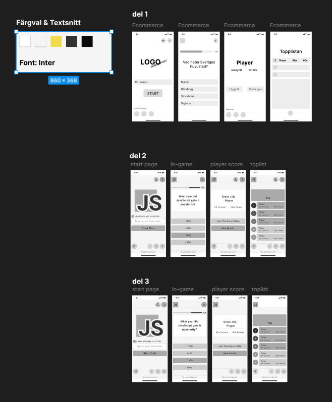

# 🎮 Quiz Game – Group 8

## 👥 Team

- Winfer
- Dante
- Alperen
- Natnael

## 📱 Om appen

Quiz Game är en interaktiv quizapp byggd med HTML, CSS och JavaScript. Spelaren börjar med att skriva in sitt namn och svarar sedan på tio frågor med fyra svarsalternativ.

Varje fråga har en tidsgräns på 20 sekunder. Rätt svar ger poäng baserat på hur mycket tid spelaren har kvar.

När quizet är klart visas resultatet med antal rätta svar och totalpoäng.

Resultaten sparas i webbläsarens `localStorage`. På topplistan visas varje spelares bästa resultat, sorterade efter poäng. Appen har även ett mörkt tema som sparas mellan besöken.

## 🎨 Design och skisser

Vi planerade appens utseende i Figma innan vi började utveckla den. Här kan du se vår designskiss:

[Öppna vårt Figma-projekt](https://www.figma.com/design/BBJSA1rzPnEWlQgMBxtVnS/Untitled?node-id=0-1&t=Er0mO4KvuH2M8Xq4-1)

## 🚀 Publicerad app

[**Spela Quiz Game här**](https://quizgame-groupeight.netlify.app/)

## 💭 Reflektion – styrkor och brister

### Styrkor

- Vi delade upp arbetet mellan gruppmedlemmarna och ansvarade för olika delar av projektet.
- Vi använde Git och GitHub för att samarbeta och hålla ordning på koden.
- Vi skapade en fungerande quizapp med poängsystem, topplista och mörkt tema.

### Brister och förbättringsområden

- Vi hade kunnat lägga mer tid på att testa appen och upptäcka buggar tidigare.
- Vi hade kunnat förbättra kommunikationen och planeringen under vissa delar av arbetet.
- Vi hade kunnat vidareutveckla funktionerna för att förbättra användarupplevelsen.
## 🤖 AI-verktyg

Vi använde AI som ett stöd under utvecklingsarbetet, bland annat för att förstå kod, felsöka problem och få förslag på lösningar.

AI användes som ett hjälpmedel, men vi ansvarade själva för att granska, förstå och anpassa koden till projektet.